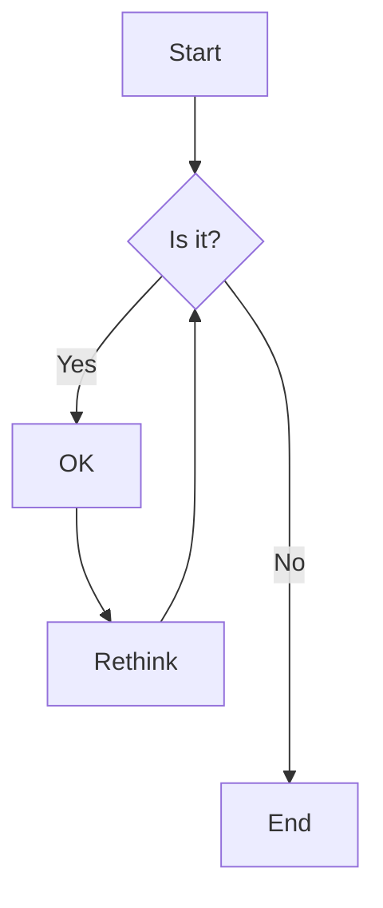


对一周前一次社团活动的总结和感想。


设计活动的时候，其实想交流的是「如何用好**现成的** AI 工具」，但是三位参与者有两位实际上更多地是在 vibe 新的工具。下面沉淀一下当时输出的内容和感想。

## 关于 vibe 小工具
如果一定选择去 vibe 一个自用的工具，那么想要得到较高的产品质量、较少的 token 耗费，就需要有一定的技术经验和 vibe 技巧。prompt 的技巧可能已经不需要了，因为 harness 会先把提示词优化一轮，并且会主动问你一些问题。**问题就在这些问题上。** 我请 zjm 展示了他 vibe 「本地笔迹脱敏工具」的截图，有下面一些想法：

+ 首个 prompt 不是不够长，而是不够清晰。事实上我一开始对「笔迹脱敏」的理解是把手写体模糊掉，或者把内容换成另一种笔迹，或者把手写的一些敏感信息模糊掉之类的。正是这种不清晰性，让 Agent 第一个问题就追问具体需求是什么。
+ 第二个问题「技术选型」，回答它还是需要一点点经验的，至少应该了解过常用的不同类型的软件是什么技术栈，不然我觉得无法做出有意义的技术选型。我不知道当时 Agent 给出了哪几个选项，以及是否备注了不同技术栈各自的优劣，如果是后者可能还好一点。

除此之外，你选择去 vibe 一个规模多大的工具，这件事情也值得考虑。我觉得还是功能独立清晰的小工具适合 vibe。并且我最喜欢的状态是，比如我想搞一个自动化爬虫脚本，我明确地知道它用什么技术栈、代码怎么写乃至要是我自己写的话需要去干哪些苦力（比如扒接口），然后我懒得自己写（自己写也慢），就把要求和网站丢给 AI，看代码对劲之后手动调一调使之更加符合自己的需要，然后这个玩意就是一个能放心自用的东西了。功能更复杂的工具，建议还是找现成的，没有成熟产品就 github。因为做一个更大的东西，性质就变了，得把它当成一个产品考虑，并且花钱让 AI 造轮子也划不来。

## 关于 AI 辅助学习
有同学提到用豆包画电路图辅助学习。我的理解是，如果用 seedance 的文生图功能去生电路图，那是十分别扭的，就相当于让艺术家去绘制精密的图纸。我觉得这种事情适合选择文本绘图，比如软工的一整套 UML 图都有对应的 mermaid 语法，那样是根据你写的内容去**确定地**渲染图片的。就像下面这样（直接用语雀给的示例了）：

由此联想，电路图有没有文本绘图的解决方案呢？现场问了一下 AI，说是 latex 的某种扩展可以做到。所以可以试试看。

此外，我和几位同学一样，会选择用 ds 来解答一些日常学习的问题，比如啃 PPT 啥的时候看不懂，拍一下让 ds 解释。ds 的识图模型效果还行，除了有些时候会把图看错，其他时候都没啥问题。

我觉得很重要的一点是，**不要让知识经过太多「手」（AI 也算）。** 讲授、翻译、总结等等，都是有损变换，所以有可能的话，尽量直接把更 raw 的内容作为学一个东西的「主阵地」，比如能看教材就不要让 AI 总结一遍然后看 slop。（当然，超短时间快速了解就是另一回事了）所谓「主阵地」，就是你主要围绕什么材料思考、针对什么材料积累东西。合适的主阵地应当密度高且经得起推敲，而 AI slop 显然不符合这两个要求，看看那些纯 AI 的 PPT 就知道了。跟开发软件一样，学习当中更适合用 AI 回答一些针对性强的具体问题，而且这个问题一定是你在尝试内化知识的时候产生的，这样就真的是 AI 在帮你学习而不是 AI 在学。

「学习的本质是突触连接的增强与减弱。」这个时间和精力是没法很大地节省的。所以除了要知道「怎么用 AI 辅助学习」，还应该知道「怎么用 AI 应付掉不是学习的任务」。对于那些前 AI 时代也不用花太多脑筋去干的苦力，尽管让 AI 去干然后验收结果就得了。省下的时间呢，就去做真正值得动脑筋的事情，去做那些真的该由**人**来做的事情。

---

当然，对「AI and its applications」的认知不是一朝一夕的事情，当然应该也不是多么困难的事情。提升这种认知的办法就是多用。~~正所谓没有 Token 的 CS 学生应该退学。~~观察各种 AI 工具的**工作过程**（Agent 会在什么时候思考？会在什么时候调用什么工具？为什么这个任务它选择用 bash 命令，那个任务它需要截图一下？），以及**结果**（我许下的愿望它完全满足我了吗？下次换个说法许愿试试？），「认识」一下它们。总之不用急，就在和 AI 交互的过程中慢慢体会吧。
