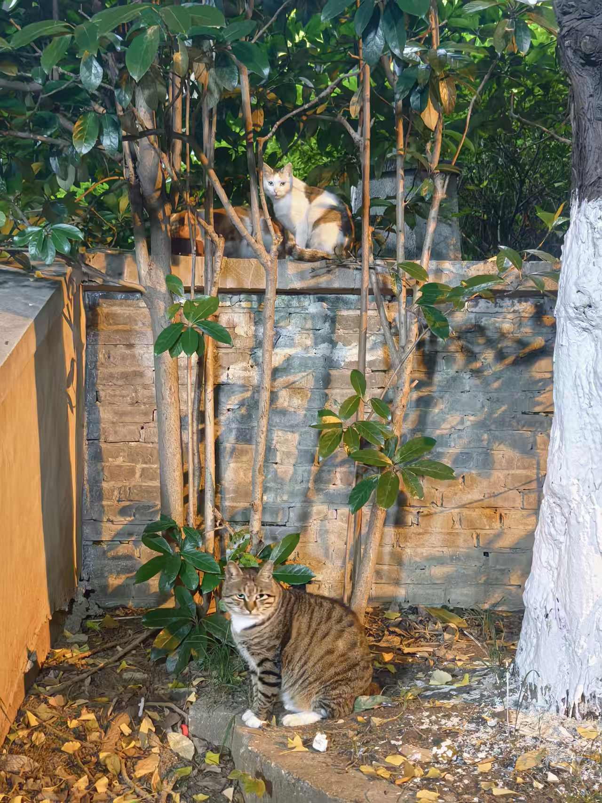
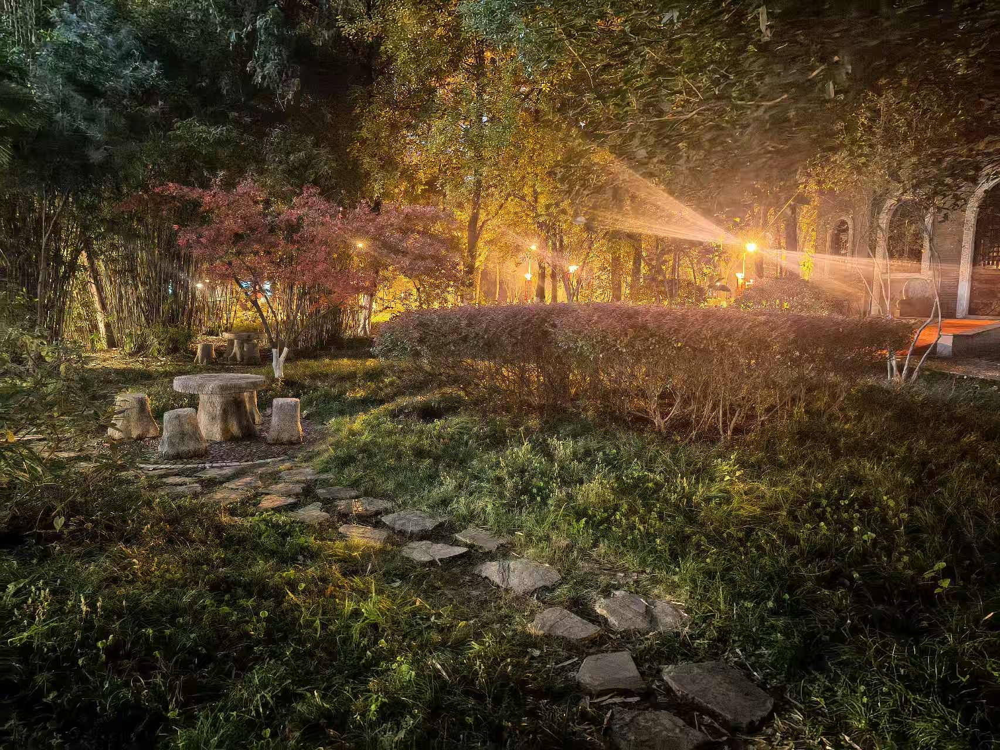

已经不止一次，在夜晚，在南教学楼或是图书馆的桌前，焦灼地，涌起一股出去走走的冲动。

已经坐了一个上午，一个下午，和一个晚上。

那还说啥呢，穿上外套，揣着手机，拾起杂志。先将最后一样安顿回原位，让它塞满下一个人一整天的空闲时间——等 AI 输出的时候、等程序跑编译和测试的时候，或是单纯看累了课件想看点别的的时候。

然后，一头扎出图书馆。

也不知道往哪里走，先到路对面再说。

我不知道我要去哪里，但我的每一步都异常坚定。

让眼睛看吧——不是句子、公式或代码，而是树叶、猫咪和行人。后者能给你直观的感受，比前者少一层解析。

甲乙楼的一个房间灯火通明，数学学院的他们在演算。

台阶旁的三只猫在开会。

想去蒙民伟楼底下，看看我上一个夏天和冬天背书的地方。可是那里在施工。（这个冬天马上又要去背了。😄）

于是，到校史馆门口的树林中间。

每次走到这里，都要感慨鼓楼校区的优美。石阶、石凳、树林、老楼，宛如公园。

树丛中的一条小径直通中大路，方便我回到图书馆。

一次还没想清缘由就结束了的「出逃」。

不必想清缘由。

